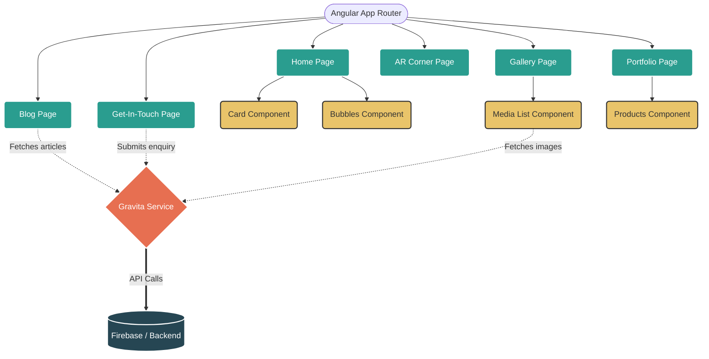

# GravitaWebTech Architecture

### Key Sections:

1. **Pages (Green):** The main routable views the user interacts with (Home, Blog, Gallery, Contact, AR).
2. **Components (Yellow):** Reusable UI pieces like the Card Carousel and Media Gallery.
3. **Services (Orange):** `GravitaService` acts as the data bridge between the UI and the backend.
4. **Backend (Dark Blue):** The external data source (e.g. Firebase) where blogs, gallery images, and contact form submissions are stored.
